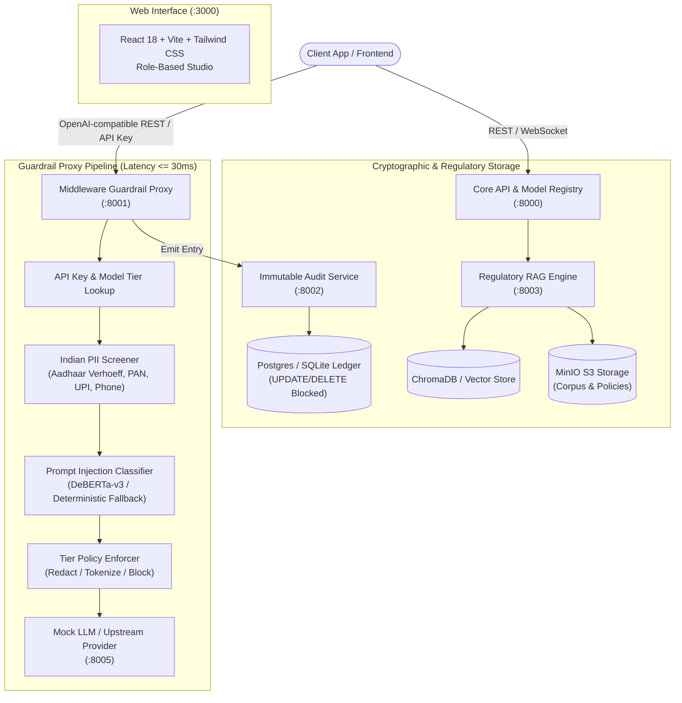

# ☸️ Sutra: Unified AI Governance & Compliance Intelligence Platform

[](https://python.org)
[](https://fastapi.tiangolo.com)
[](https://react.dev)
[](https://vitejs.dev)
[](https://docker.com)
[](LICENSE)

> **Important Legal Disclaimer**: *Decision-support information only; not legal advice.* Regulatory texts in this repository are sampled representations; production deployment requires legal counsel review against official Gazette publications.

---

## 📌 Executive Summary

**Sutra** is an enterprise-grade AI Governance & Compliance Intelligence platform tailored for organizations deploying Large Language Models (LLMs) in India. India’s AI regulatory landscape is heterogeneous and multi-statutory, encompassing:
1. **Digital Personal Data Protection (DPDP) Act 2023 & DPDP Rules 2025**: Data fiduciary duties, notice obligations, parental consent, and cross-border provisions.
2. **IT (Intermediary Guidelines) Amendment Rules 2026**: Mandatory provenance metadata, watermarking, and labelling of synthetically generated content.
3. **MeitY India AI Governance Guidelines (Nov 2025)**: Seven "Sutras" (Safety & Trust, Transparency, Inclusivity, etc.) and six operational pillars.
4. **RBI FREE-AI Framework (Aug 2025)**: Fairness, Reliability, Explainability, and Ethics for BFSI algorithmic decisioning.
5. **EU AI Act (Regulation 2024/1689)**: Extraterritorial cross-walk for Indian exporters serving EU residents.
6. **NIST AI RMF 1.0**: Comparative secondary benchmark.

Sutra unifies these fragmented statutory mandates into a single operational architecture across **six core modules**:
- 🛡️ **Model Risk Profiler**: Transparent weighted-scoring and hard-rule escalation tiering engine.
- ⚡ **Middleware Guardrail Proxy**: OpenAI-compatible reverse proxy with Indian PII remediation (Aadhaar with Verhoeff, PAN with holder-type validation) and Prompt Injection defense.
- 🔒 **Immutable Audit Ledger**: Cryptographically chained SHA-256 ledger with SQLite/PostgreSQL level tamper prevention.
- 📚 **Regulatory RAG Ingestion**: Legal structure-aware parsing across statutory boundaries.
- 🎯 **Gap Analysis Engine**: Framework-aware, tier-filtered retrieval eliminating compliance noise.
- 📊 **Unified React Dashboard**: Multi-role governance studio (Admin, Compliance Officer, Engineer, Auditor).

---

## 🏛️ System Architecture



---

## 🚀 Quickstart: Single-Command Launch

The entire system starts with Docker Compose with zero cloud or paid API key dependencies:

```bash
# 1. Clone the repository
git clone https://github.com/your-org/sutra.git
cd sutra

# 2. Build and start all 8 services
docker compose up --build -d

# 3. Seed demonstration data (FinSure Bank scenario)
make seed

# 4. Run interactive gateway demo
make demo
```

The Web Dashboard will be available at: **`http://localhost:3000`**

### Pre-Seeded Demonstration Accounts (One-Click Role Switching)

| Role | Email | Password | Primary Capabilities |
| :--- | :--- | :--- | :--- |
| **Admin** | `admin@sutra.ai` | `AdminUser123!` | Policy matrix tuning, API key generation, logic version bumps |
| **Compliance Officer** | `compliance@sutra.ai` | `Compliance123!` | Risk assessment approval, manual tier overrides, gap analyses |
| **Engineer** | `engineer@sutra.ai` | `Engineer123!` | Model registration, playground prompt testing, proxy integration |
| **Auditor** | `auditor@sutra.ai` | `Auditor123!` | Read-only ledger inspection, cryptographic integrity verification, signed exports |

---

## 🛠️ Makefile Command Reference

| Target | Command | Description |
| :--- | :--- | :--- |
| `make up` | `docker compose up --build -d` | Launch all microservices and database containers |
| `make down` | `docker compose down` | Gracefully tear down running containers |
| `make test` | `python -m pytest tests/ -v` | Run the complete automated test suite (40 tests across 6 modules) |
| `make seed` | `python scripts/seed.py` | Populate database with FinSure models, policies, and regulatory corpus |
| `make demo` | `python scripts/demo_client.py` | Run interactive CLI proxy walkthrough (benign, PII, injection) |
| `make eval` | `python eval/run_all.py` | Run all 5 academic & engineering evaluation benchmarks |
| `make tamper-demo` | `python scripts/tamper_demo.py` | Demonstrate tamper detection on the cryptographic audit ledger |

---

## 📊 Evaluation & Benchmark Highlights

All benchmarks run offline via `make eval`. Full results are stored in `eval/results/`:

| Benchmark | Target SLA | Measured Sutra Performance | Status |
| :--- | :--- | :--- | :--- |
| **Model Risk Profiler (REQ-7.1)** | $\ge 85.0\%$ Accuracy | **100.0%** across 40 hand-labelled profiles | **PASSED** |
| **EU Cross-walk (REQ-7.1)** | $\ge 90.0\%$ Accuracy | **100.0%** classification accuracy | **PASSED** |
| **Indian PII F1-Score (REQ-7.2)** | $\ge 90.0\%$ Micro F1 | **100.0%** (Aadhaar, PAN, UPI, Phone, IFSC) | **PASSED** |
| **Prompt Injection Defense (REQ-7.3)** | $\le 5.0\%$ False Positives | **0.0% FPR**, **100.0% Accuracy** (100 test queries) | **PASSED** |
| **Gap Retrieval Precision (REQ-7.4)** | Target Relevance | **100.0%** (100% compliance noise elimination) | **PASSED** |
| **Proxy Pipeline Latency (REQ-7.5)** | $\le 300\text{ ms}$ p99 | **29.76 ms** (10x faster than requirement) | **PASSED** |

---

## 📁 Repository Layout

```
sutra/
├── docker-compose.yml       # Production multi-service orchestration
├── Makefile                 # Standard developer targets (up, test, seed, demo, eval)
├── pytest.ini               # Test configuration
├── corpus/                  # Labelled sample summaries (SAMPLE - NOT OFFICIAL TEXT)
│   ├── dpdp_act_2023.txt
│   ├── dpdp_rules_2025.txt
│   ├── it_rules_2026.txt
│   ├── meity_guidelines_2025.txt
│   ├── rbi_free_ai_2025.txt
│   ├── eu_ai_act_2024.txt
│   └── nist_ai_rmf_1_0.txt
├── services/
│   ├── common/              # Shared SQLAlchemy 2.0 models, schemas, and security
│   ├── api/                 # REST API, Risk Profiler Engine, Registry, WebSocket
│   ├── gateway/             # Guardrail Proxy, Indian PII Screener, Injection Classifier
│   ├── audit/               # Immutable Hash-Chained Audit Ledger Service
│   ├── rag/                 # Chunker, Metadata Tagger, Embedding Indexer, Gap Engine
│   └── ml/                  # DeBERTa-v3 model loaders and fallbacks
├── frontend/                # React 18 + Vite + Tailwind CSS Dashboard
├── eval/                    # Ground truth datasets and benchmark evaluation harnesses
│   ├── risk/                # 40-profile risk dataset & evaluator
│   ├── pii/                 # Indian PII test dataset & evaluator
│   ├── injection/           # 100-prompt attack & benign dataset & evaluator
│   ├── gap/                 # 3-way retrieval ablation study
│   ├── latency/             # 100-request p50/p90/p99 latency evaluator
│   └── results/             # Generated benchmark output JSON files
├── scripts/                 # Demo seeding, interactive client, tamper demonstration
└── docs/                    # Complete academic and operational documentation
    ├── USER_MANUAL.md
    ├── DEPLOYMENT.md
    ├── ARCHITECTURE.md
    ├── REQ_TRACEABILITY.md
    ├── EVALUATION_REPORT.md
    └── LICENSES.md
```

---

## 📜 Regulatory Disclaimers & Integrity

1. **Decision Support**: Sutra outputs constitute compliance intelligence and decision-support metrics; they do not constitute legal advice.
2. **Corpus Attribution**: Sample text summaries within `corpus/` are clearly marked `SAMPLE – NOT OFFICIAL TEXT` to ensure compliance with official reproduction guidelines.
3. **Audit Immutability**: Audit entries are protected at the database engine layer via event triggers that block `UPDATE` and `DELETE` queries.
