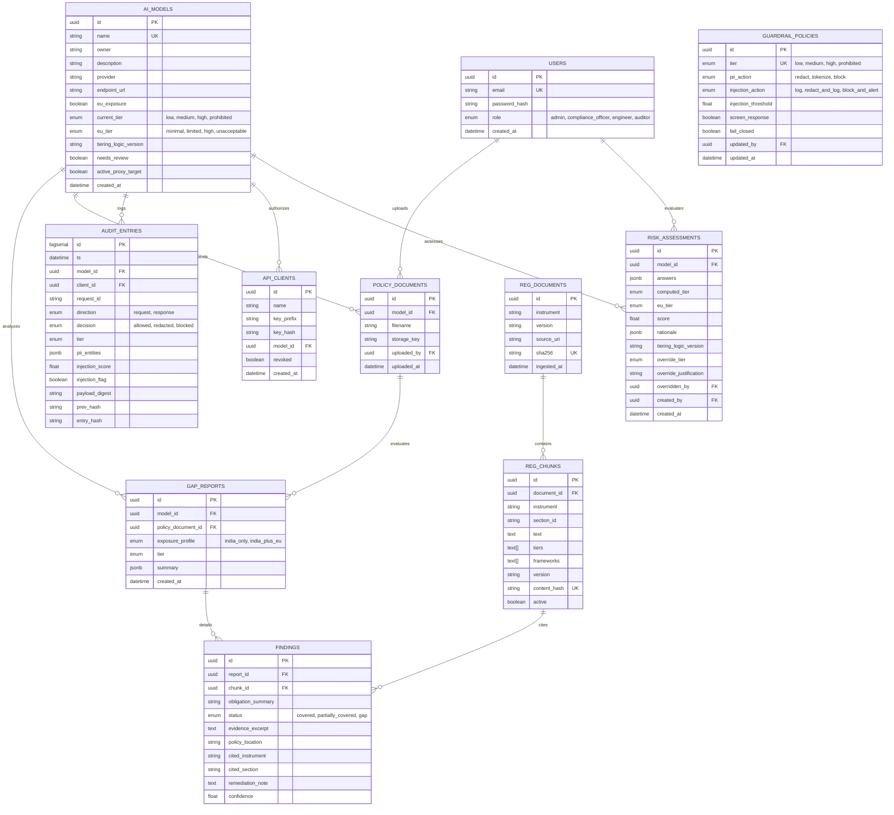
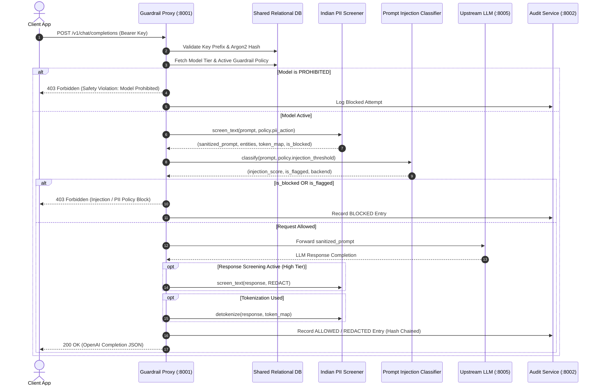
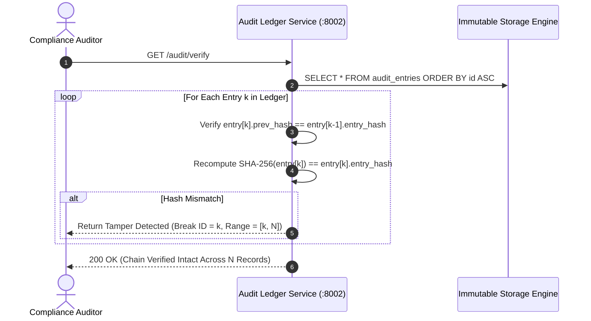
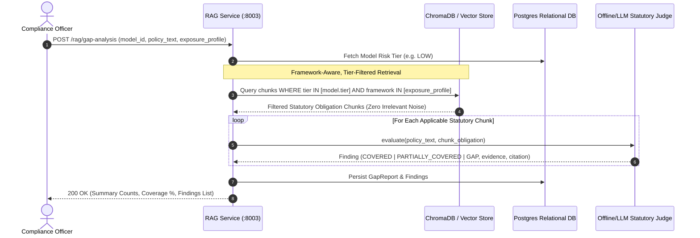

# Sutra: Technical Architecture & System Design

> **Disclaimer**: *Decision-support information only; not legal advice.*

---

## 1. Architectural Philosophy

Sutra is architected around three non-negotiable principles:
1. **Offline Sovereignty**: Zero cloud or paid API dependencies required for core compliance operations.
2. **Cryptographic Proof of Governance**: Machine-verifiable audit logs that prevent retrospective rewriting by internal or external actors.
3. **Targeted Statutory Grounding**: Elimination of compliance hallucination and noise through framework-aware, tier-filtered retrieval.

---

## 2. Entity-Relationship Model

---

## 3. Core Interaction Sequence Diagrams

### 3.1 Middleware Guardrail Proxy Pipeline

---

### 3.2 Cryptographic Hash Chaining & Tamper Detection

Every log record is cryptographically bound to its immediate predecessor:

$$\text{entry\_hash}_k = \text{SHA-256}\left(\text{prev\_hash}_{k} \mathbin{\Vert} \text{canonical\_json}(\text{record}_k)\right)$$

Where:
- $\text{prev\_hash}_1 = \text{"0"}^{64}$ (Genesis Hash)
- $\text{prev\_hash}_k = \text{entry\_hash}_{k-1}$ for $k > 1$.

---

### 3.3 Statutory Gap Analysis & Retrieval Ablation

